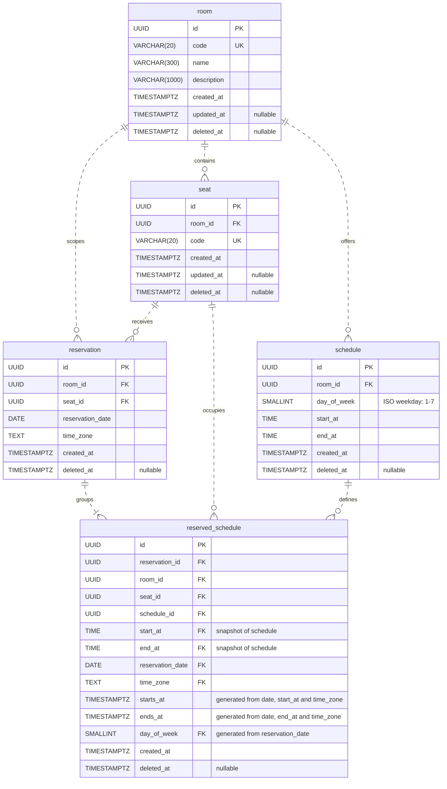

## 본 시스템의 예약 모델 설계

## 1. 전제 조건

1. 본 시스템은 다수의 방(Room)을 관리할 목적이 있음.
2. 하나의 방에는 다수의 좌석(Seat)이 있음.
3. 좌석을 예약할 수 있는 시간을 스케쥴(Schedule)이라 함.
4. 하나의 좌석에 대해 좌석이 속한 방의 스케쥴 중 하나 이상을 점유하는 것을 예약(Reservation)이라 함.

## 2. 스케쥴(Schedule)

스케쥴은 벽시계 시각으로 시작 시각, 종료 시각을 표현하고, [ISO 8601](https://wikipedia.org/wiki/ISO_8601)에 따라 요일을 숫자로 저장함.

저장되는 값은 한 주 단위로 반복되는 시간 구간을 표현하고, 같은 방 및 요일의 스케쥴끼리 시간은 겹치지 않아야 함.

겹침 여부를 판단할 때는 반폐쇄 구간을 사용함.

방과 요일이 동일한 스케쥴에서:
- `10:00:00` ~ `12:00:00` 스케쥴과 `12:00:00` ~ `13:00:00` 스케쥴은 서로 겹치지 않음.
- `10:00:00` ~ `12:00:00` 스케쥴과 `11:59:59` ~ `13:00:00` 스케쥴은 서로 겹치는 것으로 판단함.

## 3. 예약(Reservation)과 점유

예약은 특정 좌석에 대해 특정 날짜의 스케쥴 중 하나 이상을 점유하는 행위임.

1. 예약하려는 스케쥴 전부를 점유할 수 있어야 예약할 수 있음.
2. 요청한 스케쥴 중 일부만 점유하거나, 하나도 점유하지 못한 예약은 존재하지 않음.
3. 동일한 좌석 및 예약 날짜에 이미 다른 예약이 점유한 스케쥴은 예약할 수 없음.

하나의 예약이 여러 스케쥴을 점유할 수 있고, 동일한 좌석과 요일에 점유한 스케쥴은 유일해야함.

따라서 점유 개념을 분리할 필요가 있고, 점유 테이블에 좌석 식별자, 예약 날짜 그리고 스케쥴 식별자로 복합 유니크 제약을 걸 수 있음.

## 4. 스케쥴의 삭제 및 수정

스케쥴은 방을 관리하는 사용자가 삭제하고, 수정할 수 있어야함.

Hard delete 방식으로 처리할 경우 해당 스케쥴을 참조하는 예약이 점유 정보를 잃을 수 있음.

따라서 삭제 및 수정 과정은 deletedAt 속성을 기록하여 논리적 비활성화 처리하는 Soft delete와 append-only 데이터 특성이 필요함.

기존 스케쥴을 비활성화하는 것이 그 스케쥴을 참조하는 예약의 무효 처리로 이어지지는 않고, 새로운 예약이 더 이상 참조할 수 없다는 의미가 됨.

같은 요일의 스케쥴간 시간 구간 겹침을 검증할 때 비활성화된 스케쥴은 검증 대상에서 제외함.

### 4-1. 참조가 있는 스케쥴

이미 예약이 점유 중인 스케쥴이 비활성화된 경우, 비활성된 스케쥴과 같은 시간 구간으로 새 스케쥴을 만들 수 있고, 만들어진 새 스케쥴에 예약이 가능하며, 동일한 시간 구간에 예약이 중복될 수 있음.

[예약과 점유](#3-예약reservation과-점유) 섹션에서, 동일한 좌석 식별자, 날짜 그리고 스케쥴 식별자를 복합 유니크 제약으로 걸었으나, 위 문제에서는 스케쥴 식별자가 다르기 때문임.

Soft delete를 적용하기 전 스케쥴 구조는 동일한 좌석과 요일에서 서로 시간 구간이 겹치지 않았고, 점유 테이블도 서로 다른 스케쥴 식별자를 참조하므로 예약한 시간이 겹치지 않음을 보장 받았음.

그러나 스케쥴에 Soft delete가 적용되면서 서로 다른 스케쥴이라는 점이 시간 구간을 겹치지 않도록 보장해주지 않음.

따라서 점유 테이블은 동일한 좌석을 점유하는 예약들의 시간 구간이 겹치지 않음을 자체적으로 보장해야함.

## 점유 테이블에서 시간 구간 겹침을 방어하는 방법

두 가지 방법을 생각함.

첫 번째는 점유 정보를 만들 때 참조한 스케쥴의 벽시계 시간 구간을 복사하고, 그 구간끼리 겹치지 않도록 하는 것으로, 시스템 운용 지역이 한 지역에 고정되고 DST 처리 요구 사항이 없다면 가능함.

두 번째는 앞 선 방법에 이어서 겹침을 검사할 시간 구간에 예약 날짜와 운용하는 지역 시간대를 적용하여 절대 시간 구간을 파생하고, 이 구간끼리 겹치지 않도록 하는 것임.

## 판단 및 결과

첫 번째 방법은 시스템 시간대 및 DST를 고려해야하는 운영 맥락이 생긴다는 점과,

스케쥴과 점유는 모두 시간 구간이 겹치지 않도록 해야하고, 특히 점유는 특정 날짜에 실제로 발생하는 자원의 사용을 표현하는 데이터라는 점에 주목함

따라서 DST로 인해 모호하거나 존재하지 않는 벽시계 시각을 절대 시각으로 해석하고, 이를 기준으로 겹침을 판단하는게 적절하다고 판단함.

마이그레이션은 두 번째 방법을 채택하여 스키마 설계를 진행함. 현재 설계는 PostgreSQL의 시간대 해석 규칙을 활용함.

## 최종 ER 다이어그램

현재 마이그레이션의 테이블과 컬럼을 기준으로, 예약이 하나 이상의 점유를 포함한다는 도메인 규칙을 함께 표현함.
`TIMESTAMPTZ`는 PostgreSQL의 `TIMESTAMP WITH TIME ZONE`을 줄여 쓴 표기임.

## 5. 방 이용 제한(Blackout)

Blackout은 물리적인 방 이용 불가 상황이나 예정된 점검의 절대 시간 구간을 표현한다.
예약을 신청한 서버 현재 시각이 아니라, 요청한 실제 이용 구간과 점검 기간이 겹치는지 판단한다.

- 각 스케줄의 로컬 시작·종료 시각에 이용 날짜와 예약 생성에 사용하는 애플리케이션 시간대를 적용한다.
- 각 이용 구간과 삭제되지 않은 방의 blackout을 `[시작, 종료)` 기준으로 비교한다. 부분 중복은 차단하고 경계만 맞닿으면 허용한다.
- 여러 선택 스케줄은 개별 구간으로 검사하므로, 슬롯 사이 공백에만 있는 점검은 예약을 막지 않는다.
- 미래 점검과 겹치는 이용은 지금 예약해도 차단한다. 현재 점검 중이어도 점검과 겹치지 않는 미래 이용은 허용한다.
- 예약 생성과 예약 가능 좌석 조회는 같은 이용 구간 검사 포트를 사용한다.

기존 `schedule_id`와 API의 `scheduleId`는 등록 당시의 스케줄을 나타내는 정보로 유지한다.
이는 제한의 범위를 특정 슬롯으로 좁히지 않는다. 같은 방의 다른 슬롯과 교체된 슬롯에도 점검 기간이 적용되며,
등록 스케줄이 폐기되어도 blackout 자체가 삭제되지 않았다면 유효하다. 기존 저장 데이터에도 이 방 단위 의미를 적용한다.

예약 생성은 방의 공유 잠금을 유지하며, 점검 생성·기간 변경·삭제는 같은 방을 배타적으로 잠근다.
잠금 순서는 방, 등록 스케줄, blackout 순서이다. 사유만 변경하는 경우 blackout만 잠근다.
스케줄 조회의 `now`는 특정 순간의 방 이용 상태를 표시하는 조회 시점이며, 날짜별 예약 가능성 판정을 대신하지 않는다.

기존 예약의 자동 취소나 고객 통지는 수행하지 않는다. 이미 예약된 시간과 겹치는 점검 등록 시 처리 정책은 별도 범위이다.
